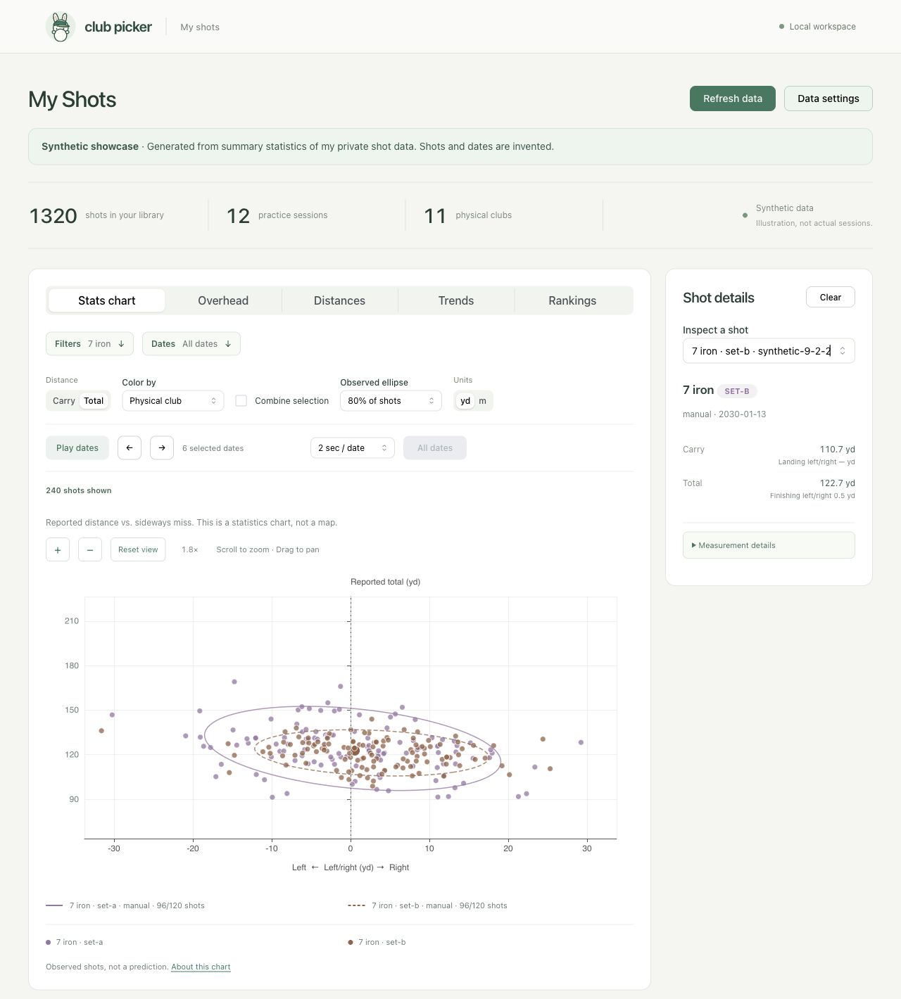

# Club Picker

Building a personalized golf caddie from my own shot data.

My handicap has been hovering around 20 for a while now. I mostly know my club
distances, but that really means a few ballpark numbers in my head and roughly
10 yards between each club. Enough to pick something, but probably not the
whole picture of how I actually play.

I practice with Toptracer and Trackman, so I already have all these shots
recorded. It feels like there should be more I can get out of them than another
yardage to remember. Maybe one club is more consistent than I think. Maybe my
misses have been drifting left or right lately. Maybe the club that can reach
the target on a good swing is also the one that gets me into trouble most often.

I can remember roughly how far a club goes. Keeping track of all those patterns
across my bag is a lot harder. That is what made me want to see if I could build
my own personalized caddie: something that knows my version of a 7-iron, and
helps me make a choice with a little more information than what is in my head.

## The idea

I want to give it a distance and see which club makes sense, what a typical
shot looks like, and what happens if I miss. Sometimes I might want the safer
choice. Other times I might be happy to take a chance if a good shot pays off.
I would like the advice to change as my game changes, too.

Further down the line, I would love to try it through my Meta Ray-Ban Display
glasses: look at the hole, ask for advice, and see or hear a short recommendation.
That is the longer-term idea. I am starting by exploring my shots locally.

It also gives me a reason to train models on something I care about. I am curious
whether they can pick up changes in my game that I would miss, and whether that
actually helps when I am standing over the next shot.

## Where it stands

I can now explore my reviewed shots in a local UI: carry and total, dispersion,
club filters, and a session timeline. My two club sets stay separate, and missing
measurements stay visible. A first approach picker compares clubs by typical
carry, with optional rangefinder plays-like yardage. Model experiments, hazard
risk, and offline phone use are still ahead.

*Synthetic shots generated from summary statistics of my own private data.
Shots and dates are invented.*

[More screenshots and how the demo data is made](docs/showcase.md) ·
[Run the local explorer](docs/explorer.md).

- [Project journey](docs/README.md): the decisions, experiments, and lessons as
  the project develops.
- [Direction and milestones](docs/roadmap.md): what I am working toward.
- [Modeling approach](docs/approach.md): how I plan to turn shots into advice.
- [Development setup](docs/development.md): tools and commands.

Code and documentation are available under the [MIT License](LICENSE).
