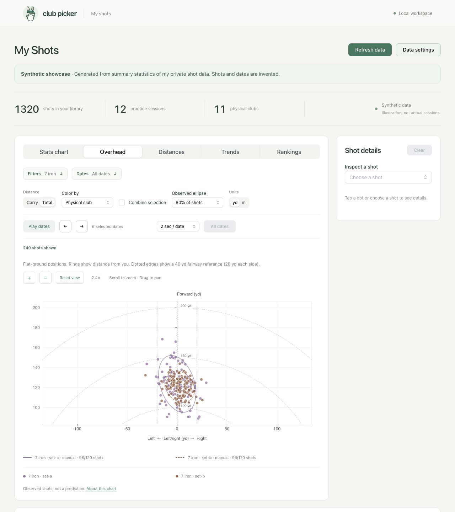
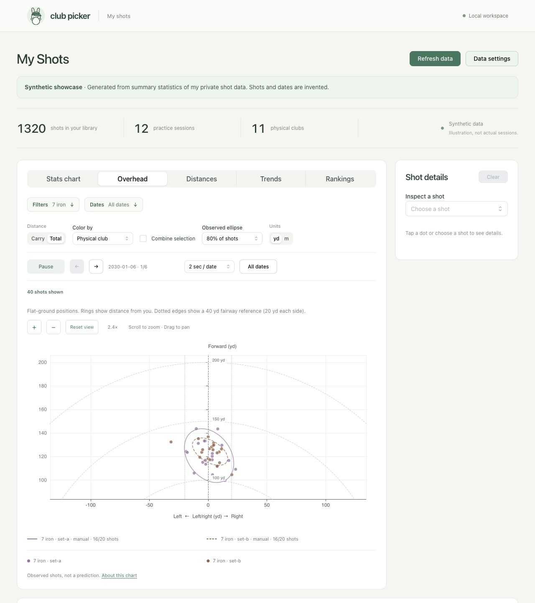
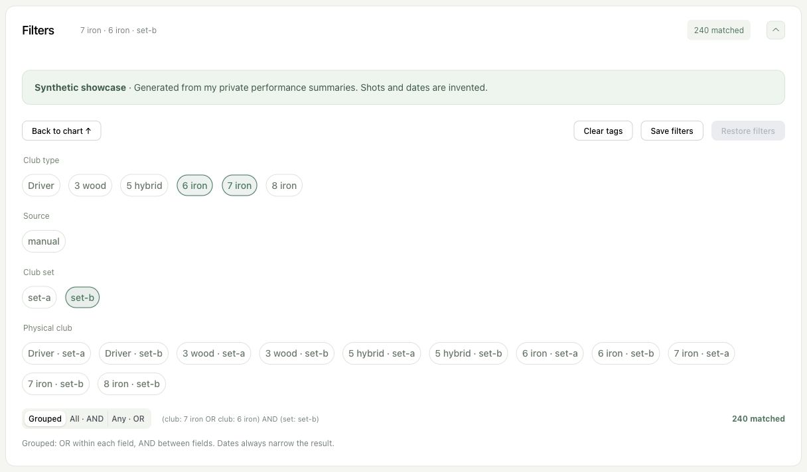
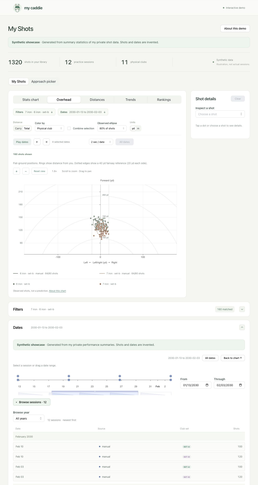
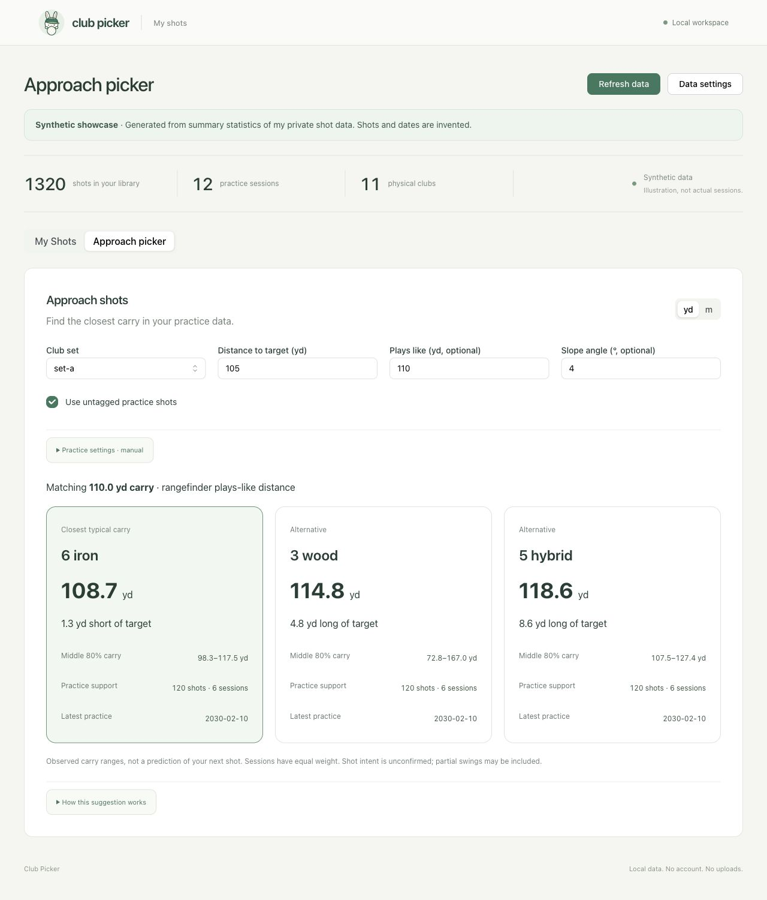

# A Look at My Shots

I wanted a way to explore my whole bag without jumping between practice apps.
These screenshots show the local explorer using **synthetic shots generated
from summary statistics of my own private shot data**. Individual shots,
dates, session sizes, and session order are invented. The timeline does not
represent my actual progress.

## Dispersion and shot details

I can compare my two 7-irons, inspect a shot, or combine the selection into one
observed dispersion ellipse. Carry and total stay separate.


## Overhead

The overhead view converts radial total distance and sideways offset into a
flat-ground position. Distance rings and a 40-yard fairway reference help put
misses in perspective. This is a zoomed view of generated seven-iron shots,
not a map of a real course.



## Play dates

Play dates steps through the current selection one practice date at a time.
I can pause, step backward or forward, change the speed, or return to all dates.
This frame shows playback running on the first of six invented dates, with
40 shots instead of the full 240-shot selection.



## Filters

All available tags stay visible. Here I selected six-irons or seven-irons,
limited to Set B. Grouped matching means OR within a field and AND between fields.
I can also use All or Any matching, and save a filter selection for later.



## Dates and sessions

I can choose a start and end date, drag a timeline range, or browse individual
sessions by month and year. This screenshot shows an invented date range with
the session list expanded. Browsing the list does not itself select a session.



## Trends

Daily medians and middle 80% ranges let me see how a selected group varies over
time. These particular fluctuations are generated, not measured changes in my game.


## Repeatability

Rankings compare the middle 80% width, relative spread, or sideways misses.
The numbers below describe the generated sample, not an evaluation of my real clubs.


## Reproduce the showcase locally

```bash
uv run python scripts/generate_showcase.py
npm ci --prefix web
npm run showcase --prefix web
```

Open `http://127.0.0.1:5174`. This mode reads the committed synthetic file and
does not load the private repo snapshot or restore a browser library. Nothing
is deployed. Regular local use remains `npm run dev --prefix web`.

The [aggregate profile](../data/public/showcase-profile.json) contains per-club
means and covariance for carry, roll (total minus carry), and finishing side,
in meters and square meters respectively. I pooled provider and measurement
contexts within each physical club for this illustration, using usable shots
with all three values and at least 20 contributing shots per club. This pooling
is not a recommendation model or proof that the providers are interchangeable.

A fixed random seed generates correlated Gaussian samples from those summaries.
Generated total distances are explicitly marked as radial so overhead can render
them without assuming geometry for unmarked manual measurements. Carry-side
geometry remains unknown. Carry and roll are bounded below, extreme sideways offsets are capped, and
measurements are rounded to two decimals. Those transformations and random
sampling mean the generated sample does not exactly reproduce the aggregate
statistics or real distribution tails. Missing carry-side and flight fields stay
absent. The generator needs only the public aggregate profile, not private files.
No raw shot rows, actual dates, provider identifiers, report links, or locations
are included in the dataset or screenshots. Aggregate performance is deliberately
shared under my [data policy](data-policy.md); this is not a formal anonymization
or differential-privacy guarantee.

## Approach picker

I can enter target yardage, optionally use my rangefinder's plays-like distance,
and compare the closest typical carries from one set. These suggestions use the
same synthetic demonstration data as the explorer, not real course outcomes.


